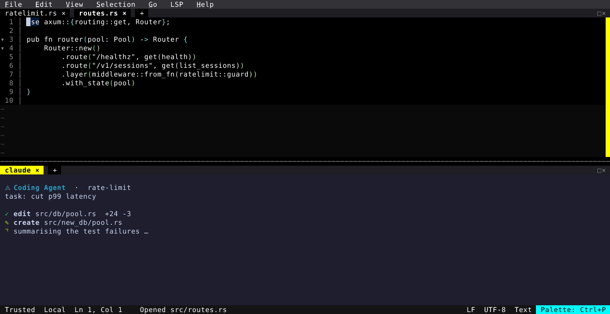

# Fresh

A modern, full-featured terminal text editor, **with zero configuration**. Familiar keybindings, mouse support, and IDE-level features — no learning curve required.

[Official Website](https://sinelaw.github.io/fresh/) &nbsp;·&nbsp; [Documentation](https://getfresh.dev/docs) &nbsp;·&nbsp; [Discord](https://discord.gg/gqGh3K4uW3) &nbsp;·&nbsp; [Contributing](#contributing)

**[Quick Install](#installation):** &nbsp; `curl -fsSL https://raw.githubusercontent.com/sinelaw/fresh/refs/heads/master/scripts/install.sh | sh`

---


Fresh brings the intuitive UX of VS Code and Sublime Text to the terminal. Standard keybindings, full mouse support, menus, and a command palette — everything works the way you'd expect, right out of the box. No modes, no memorizing shortcuts.

Built for real-world performance: Fresh handles [multi-gigabyte files](https://noamlewis.com/blog/2025/12/09/how-fresh-loads-huge-files-fast) with negligible memory overhead and delivers consistently low-latency input, regardless of file size.

### Command Palette & Fuzzy Finder

One shortcut to find files, run commands, switch buffers, and jump to any line.


### Multitask with the Orchestrator

Start each task in its own worktree, hop between them with an arrow key, and leave the rest running.



### Multi-Cursor Editing

Select and edit multiple occurrences simultaneously — the same workflow you know from graphical editors.


### Themes & Customization

Browse and apply color themes instantly. Full settings UI and interactive keybinding editor included.


See more feature demos: [Editing](https://getfresh.dev/docs/blog/editing) (search & replace, block selection, sort lines, ...) · [Productivity](https://getfresh.dev/docs/blog/productivity) (file explorer, split view, integrated terminal, ...) · [Themes](https://getfresh.dev/docs/blog/themes)

---

## Feature Overview

| Category | Features |
|----------|----------|
| **File Management** | open/save/new/close, file explorer, tabs, recent files, auto-revert, git file finder, compare files (`fresh --diff`) |
| **Editing** | undo/redo, multi-cursor, block selection, smart indent, comments, clipboard, vi and Emacs keymaps |
| **Search & Replace** | incremental search, find in selection, query replace, git grep |
| **Navigation** | go to line/bracket, word movement, position history, bookmarks, error navigation |
| **Views & Layout** | split panes, line numbers, line wrap, backgrounds, markdown preview and table of contents |
| **Language Server (LSP)** | go to definition, references, hover, code actions, rename, diagnostics, autocompletion |
| **Git** | review diff with comments, git blame, git log |
| **Productivity** | command palette, menu bar, keyboard macros, diagnostics panel |
| **Multitasking (Orchestrator)** | one workspace per git worktree, terminals and long-running commands per workspace, coding agents (claude, codex, opencode, aider) with resumable sessions, import of agent sessions started outside Fresh, Workboard overview, dock switcher, remote/SSH workspaces |
| **Background editor** | `fresh` runs in a background editor you can detach from and reattach to (Auto Attach) |
| **Extensibility** | TypeScript plugins (sandboxed QuickJS), merge conflicts, path complete, keymaps; color and TODO highlighters available as packages |
| **Internationalization** | Multiple language support (see [`locales/`](crates/fresh-editor-core/locales)), plugin translation system |

## Installation

Quick install:

`curl -fsSL https://raw.githubusercontent.com/sinelaw/fresh/refs/heads/master/scripts/install.sh | sh`

**On Linux, the universal build is the recommended install**, and it's what the
script installs: one statically linked binary that runs on every distro,
unpacked under `~/.local`, owned by you. It needs no root, and it updates itself
(see [Upgrading](#upgrading)). On macOS the script uses Homebrew.

`fresh --update` asks before installing (`--yes` skips the question). However
you installed Fresh — Homebrew, a package, cargo, npm and so on — it updates
through that same channel; for Flatpak and a few others it tells you the command
to run.

Prefer your distro's package manager? Ask for it explicitly:

```bash
curl -fsSL .../install.sh | sh -s -- --method=deb    # also: rpm, aur, nix, cargo, npm, brew, appimage
```

Packages are fully supported — they are opt-in rather than the default because
installing one needs root and hands updates to that package manager. `fresh`
records how it was installed either way, and updates through that same
mechanism. `--method=auto` restores the old autodetecting behaviour, and
`install.sh --help` lists everything.

Or, pick your preferred method:

| Platform | Method |
|----------|--------|
| Linux (any distro) — **recommended** | [universal build](#universal-build-linux) — self-updating, no root |
| macOS | [brew](#brew) |
| Bazzite/Bluefin/Aurora Linux | [brew](#brew) |
| Windows | [winget](#windows-winget) |
| Arch Linux | [AUR](#arch-linux-aur) |
| Debian/Ubuntu | [.deb](#debianubuntu-deb) |
| Fedora/RHEL | [.rpm](#fedorarhel-rpm), [Terra](https://terra.fyralabs.com/) |
| OpenSUSE | [.rpm](#opensuse-rpm) |
| FreeBSD | [ports / pkg](https://www.freshports.org/editors/fresh) |
| Gentoo | [GURU](#gentoo-guru) |
| Solus | [eopkg](#solus-eopkg) |
| Linux (sandboxed / portable) | [AppImage](#appimage), [Flatpak](#flatpak) |
| Desktop app (Windows, macOS, Linux) | [Fresh Desktop](#fresh-desktop) |
| All platforms | [Pre-built binaries](#pre-built-binaries) |
| npm | [npm / npx](#npm) |
| Rust users (Fast) | [cargo-binstall](#using-cargo-binstall) |
| Rust users | [crates.io](#from-cratesio) |
| Nix | [Nix flakes](#nix-flakes) |
| Developers | [From source](#from-source) |

### Universal build (Linux)

The recommended way to run Fresh on Linux:

```bash
curl -fsSL https://raw.githubusercontent.com/sinelaw/fresh/refs/heads/master/scripts/install.sh | sh
```

A single static (musl) binary for `x86_64` and `aarch64` with every feature
compiled in, including plugins. It unpacks to `~/.local/share/fresh-editor` and
symlinks `~/.local/bin/fresh`; set `FRESH_INSTALL_DIR` / `FRESH_BIN_DIR` to put
them elsewhere. Ensure `~/.local/bin` is in your `PATH`.

#### Upgrading

Because nothing else owns these files, this is the one Linux install that can
replace itself. Any of these upgrades to the latest release:

- **From the shell:** `fresh --update`. It shows your version and the latest one,
  and asks before installing; `--yes` skips the question and `--check` only reports whether an
  update is available.
- **From the editor:** when a new release is out, an update indicator appears in
  the status bar. Click it, or run **Update fresh** from the command palette.
- **Re-run the install script.** This also refreshes the desktop entry and
  icons, which an in-place update leaves alone.

Each update downloads the release, verifies it against both its published
checksum and GitHub's release attestation, and swaps the binary in place.

The archive also carries the same desktop entry and icon theme the `.deb` and
`.rpm` install, and the installer copies them into `$XDG_DATA_HOME`
(`~/.local/share` by default) so Fresh shows up in your application menu. Pass
`--no-desktop-integration`, or set `FRESH_NO_DESKTOP=1`, to skip that — usually
what you want on a server or in a container. Every file written outside the
install directory is listed in
`~/.local/share/fresh-editor/installed-files.txt`, so re-running the installer
cleans up after the previous run and uninstalling is `rm` over that list plus
the install directory and the symlink.

Downloading the archive by hand from the [releases
page](https://github.com/sinelaw/fresh/releases) works the same way — it ships
the same install receipt, so a hand-unpacked copy self-updates too. Only the
binary is swapped on update, so the desktop entry and icons are refreshed by
re-running the installer, not by `fresh --cmd update`.

### Brew

On macOS and some linux distros (Bazzite/Bluefin/Aurora):

> **Note:** On macOS, see [macOS Terminal Tips](https://getfresh.dev/docs/configuration/keyboard#macos-terminal-tips) for recommended terminal configuration.

```bash
brew install fresh-editor
```

### Windows (winget)

```bash
winget install fresh-editor
```

Alternatively, Windows users can use [npm](#npm), or download
`fresh-gui-<target>.zip` from the [releases page](https://github.com/sinelaw/fresh/releases):
opened from Explorer it runs in its own window, and typing `fresh-gui` in cmd or
PowerShell runs it in the console.

### Arch Linux ([AUR](https://aur.archlinux.org/packages/fresh-editor-bin))

**Binary package (recommended, faster install):**

```bash
git clone https://aur.archlinux.org/fresh-editor-bin.git
cd fresh-editor-bin
makepkg --syncdeps --install
```

**Build from source:**

```bash
git clone https://aur.archlinux.org/fresh-editor.git
cd fresh-editor
makepkg --syncdeps --install
```

**Using an AUR helper (such as `yay` or `paru`):**

```bash
# Binary package (recommended, faster install)
yay -S fresh-editor-bin

# Or build from source
yay -S fresh-editor
```

### Debian/Ubuntu (.deb)

Download, verify and install the latest release:

```bash
curl -fsSL https://raw.githubusercontent.com/sinelaw/fresh/refs/heads/master/scripts/install.sh | sh -s -- --method=deb
```

Or download the `.deb` file manually from the [releases page](https://github.com/sinelaw/fresh/releases)
(`fresh-editor_VERSION-1_ARCH.deb`).

### Fedora/RHEL (.rpm)

Download, verify and install the latest release:

```bash
curl -fsSL https://raw.githubusercontent.com/sinelaw/fresh/refs/heads/master/scripts/install.sh | sh -s -- --method=rpm
```

Or download the `.rpm` file manually from the [releases page](https://github.com/sinelaw/fresh/releases).

### OpenSUSE (.rpm)

There is no openSUSE repository for `fresh` yet, so install the `.rpm` from the
release directly:

```bash
curl -fsSL https://raw.githubusercontent.com/sinelaw/fresh/refs/heads/master/scripts/install.sh | sh -s -- --method=rpm
```

The installer uses `zypper` when it finds it.

Or download the `.rpm` file manually from the [releases page](https://github.com/sinelaw/fresh/releases).

### Gentoo ([GURU](https://wiki.gentoo.org/wiki/Project:GURU))

Enable the repository as read in [Project:GURU/Information for End Users](https://wiki.gentoo.org/wiki/Project:GURU/Information_for_End_Users) then emerge the package:


```bash
emerge --ask app-editors/fresh
```

### Solus (eopkg)

Fresh is the official repository. Run eopkg to install:


```bash
sudo eopkg it fresh
```

### AppImage

> On most systems the [universal build](#universal-build-linux) is the better
> choice: same "runs anywhere" property, no FUSE dependency, and no mount
> overhead on each launch. `install.sh` no longer selects AppImage
> automatically — pass `--method=appimage` if you specifically want it.

Download the `.AppImage` file from the [releases page](https://github.com/sinelaw/fresh/releases) and run:

```bash
chmod +x fresh-editor-VERSION-x86_64.AppImage
./fresh-editor-VERSION-x86_64.AppImage
```

**For faster startup** (recommended): Extract the AppImage instead of running it directly. This avoids the FUSE mount overhead on each launch (~10x faster):

```bash
./fresh-editor-VERSION-x86_64.AppImage --appimage-extract
mkdir -p ~/.local/share/fresh-editor ~/.local/bin
mv squashfs-root/* ~/.local/share/fresh-editor/
ln -sf ~/.local/share/fresh-editor/usr/bin/fresh ~/.local/bin/fresh
```

Ensure `~/.local/bin` is in your PATH. Available for x86_64 and aarch64 architectures.

### Flatpak

Download the `.flatpak` bundle from the [releases page](https://github.com/sinelaw/fresh/releases) and install:

```bash
flatpak install --user fresh-editor-VERSION-x86_64.flatpak
flatpak run io.github.sinelaw.fresh
```

See [crates/fresh-editor/flatpak/README.md](crates/fresh-editor/flatpak/README.md) for building from source.

### Fresh Desktop

A standalone desktop application: Fresh in its own window, with the editor
bundled inside, so there is nothing else to install and no browser or terminal
to open. Download it from the [releases page](https://github.com/sinelaw/fresh/releases):

| Platform | File |
|----------|------|
| Windows (x64) | `fresh-desktop-VERSION-windows-x64-setup.exe` |
| macOS (Intel and Apple Silicon) | `fresh-desktop-VERSION-macos-universal.dmg` |
| Linux (x86_64) | `fresh-desktop-VERSION-linux-x86_64.AppImage` |

It opens your home directory, or the folder or files you open it with, and
remembers each project's session like the terminal edition does. The builds
are not signed with a developer certificate yet. On macOS, the first launch is
refused; allow it under **System Settings → Privacy & Security → Open Anyway**
(or run `xattr -dr com.apple.quarantine "/Applications/Fresh Desktop.app"`).
On Windows, choose **More info → Run anyway** in the SmartScreen prompt.
Update by installing a newer release.
To build it from source instead (needs Rust and Node.js), run this from a
checkout. It builds this platform's package (an AppImage on Linux, a `.dmg` on
macOS, an installer on Windows) into `desktop/dist/`:

```bash
node desktop/scripts/package.js
```

See [desktop/README.md](desktop/README.md) for details.

### Pre-built binaries

Download the latest release for your platform from the [releases page](https://github.com/sinelaw/fresh/releases).

On Linux, prefer the `-unknown-linux-musl` archives: they are statically linked,
so they run on any distro regardless of its glibc version, and they are gzipped
so a stock `tar` can unpack them without `xz-utils`. Every archive carries an
install receipt, so an unpacked copy knows how to update itself.

### Using mise

```bash
mise use github:sinelaw/fresh
```

### npm

```bash
npm install -g @fresh-editor/fresh-editor
```

Or try it without installing:

```bash
npx @fresh-editor/fresh-editor
```

### Using cargo-binstall

To install the binary directly without compiling (much faster than crates.io):

First, install cargo-binstall if you haven't already

```bash
cargo install cargo-binstall
```

Then install fresh

```bash
cargo binstall fresh-editor
```

### Nix flakes

The latest release is packaged in
[nixpkgs unstable](https://search.nixos.org/packages?channel=unstable&query=fresh-editor)
as `fresh-editor`:
```bash
nix profile add nixpkgs#fresh-editor
```

For declarative management, add `pkgs.fresh-editor` to your
[NixOS](https://nixos.org/manual/nixos/stable/#sec-declarative-package-mgmt),
[Home Manager](https://nix-community.github.io/home-manager/), or
[nix-darwin](https://github.com/LnL/nix-darwin) configuration.

To follow `master` instead, use this repository's flake. Run without installing:
```bash
nix run github:sinelaw/fresh
```

Or install to your profile:
```bash
nix profile add github:sinelaw/fresh
```

### From crates.io

```bash
cargo install --locked fresh-editor
```

### From source

```bash
git clone https://github.com/sinelaw/fresh.git
cd fresh
cargo build --release
./target/release/fresh [file]
```

## Documentation

- [User Guide](https://getfresh.dev/docs)
- [macOS Tips](https://getfresh.dev/docs/configuration/keyboard#macos-terminal-tips) - Terminal configuration, keyboard shortcuts, and troubleshooting for Mac users
- [Plugin Development](https://getfresh.dev/docs/plugins/development)

## Contributing

See [CONTRIBUTING.md](CONTRIBUTING.md) for guidelines.

## Privacy

Fresh checks for new versions daily to notify you of available upgrades. Alongside this, it sends basic anonymous telemetry (version, OS/architecture, terminal type) to help understand usage patterns. No personal data or file contents are collected.

To disable both upgrade checks and telemetry, use `--no-upgrade-check` or set `check_for_updates: false` in your config.

## License

Copyright (c) Noam Lewis

This program is free software: you can redistribute it and/or modify it under
the terms of the GNU General Public License as published by the Free Software
Foundation, either version 3 of the License, or (at your option) any later
version (GPL-3.0-or-later).

This program is distributed in the hope that it will be useful, but WITHOUT ANY
WARRANTY; without even the implied warranty of MERCHANTABILITY or FITNESS FOR A
PARTICULAR PURPOSE. See the [GNU General Public License](LICENSE) for more
details.

SPDX-License-Identifier: GPL-3.0-or-later
