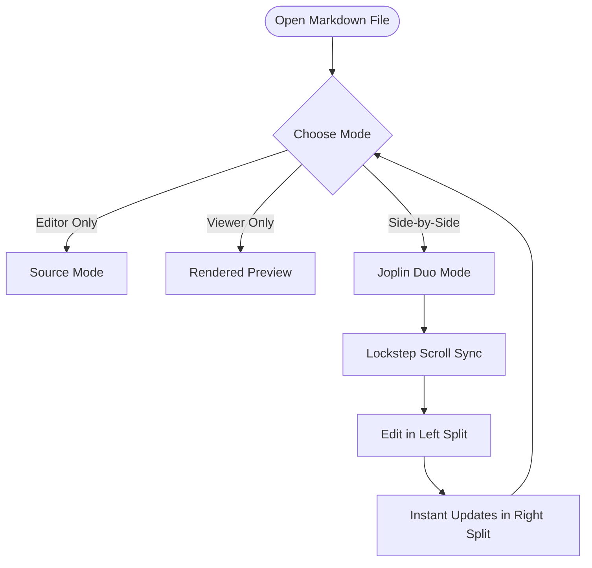
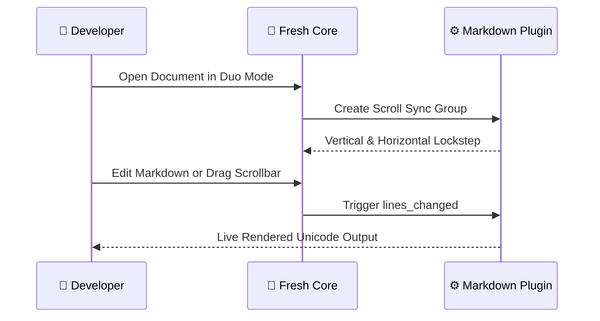
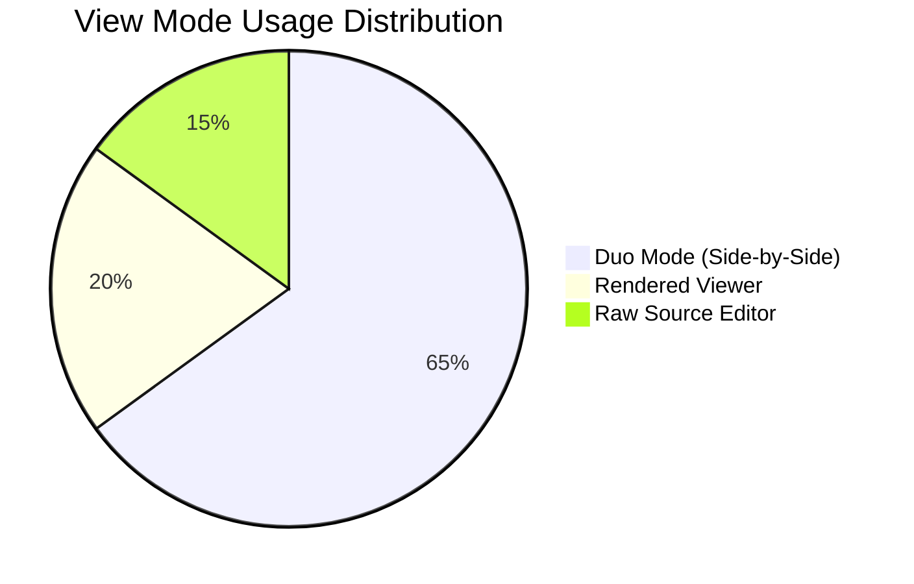

# 🚀 Fresh Markdown Showcase: Joplin 3-Mode Viewing & Rich Rendering

Welcome to **Fresh Markdown Preview & Compose Mode**! This document demonstrates the 3-mode viewing lifecycle inspired by note-taking apps like Joplin, lockstep scrollbar synchronization, rich Unicode tables, Mermaid diagramming, and LaTeX mathematical equation rendering.

---

## 🧭 1. Joplin-Style 3-Mode View Controls

Open the Command Palette (**`Ctrl+P`** or **`F1`**) and search for **`Markdown:`**:

| Command | Action | Description |
|---|---|---|
| `Markdown: Cycle View Mode` | **Cycle** | Cycles: `Source (Editor)` ➔ `Rendered (Viewer)` ➔ `Duo (Editor + Viewer)` |
| `Markdown: Toggle Duo Mode` | **Toggle** | Quickly toggles between single pane and side-by-side Duo split |
| `Markdown: Mode: Source (Editor)` | **Source** | Traditional unrendered text editor view |
| `Markdown: Mode: Rendered (Viewer)` | **Rendered** | Full-width rendered view with Unicode borders, conceals & diagrams |
| `Markdown: Mode: Duo (Editor + Viewer)`| **Duo** | Left pane: raw source editor; Right pane: live rendered viewer |

> [!TIP]
> **Lockstep Horizontal & Vertical Scrollbar Sync in Duo Mode:**
> When Duo mode is active, scrolling vertically or dragging/scrolling the **horizontal scrollbar** at the bottom will smoothly synchronize both the editor and preview splits in real-time.

---

## 📊 2. High-Performance Markdown Tables

Tables feature dynamic column width allocation, multi-line row wrapping, text styling, and clean Unicode box-drawing borders (`┌─┬─┐`, `├─┼─┤`, `└─┴─┘`):

| Subsystem | Status | Precision | Latency | Architecture & Key Highlights |
|---|---|---|---|---|
| **Text Layout** | 🟢 Active | **99.9%** | 1.2 ms | Virtual lines, conceals, soft wrapping, and cursor-reveal scopes. |
| **Scroll Sync** | 🟢 Synced | **100.0%** | 0.4 ms | Dual-axis lockstep sync (vertical lines & horizontal columns). |
| **Mermaid Engine**| 🟢 Online | **98.5%** | 2.1 ms | Flowcharts, sequence diagrams, state machines, and pie charts. |
| **LaTeX Math** | 🟢 Online | **99.2%** | 1.8 ms | Fractions, roots, Greek symbols, superscripts, and display blocks. |
| **Plugin Core** | 🟢 Stable | **100.0%** | 0.8 ms | QuickJS runtime with full UTF-16 surrogate & emoji safety. |

---

## 📈 3. Mermaid Diagrams in the Terminal

Fenced code blocks marked with ```` ```mermaid ```` automatically render as interactive Unicode diagrams. When your cursor enters the diagram block, it reveals the raw source for instant editing!

### Flowchart with Decisions & Cycles


### Sequence Diagram with Participants & Notes


### Distribution Pie Chart


---

## 📐 4. LaTeX Mathematical Equation Rendering

Render mathematical equations directly in the terminal without external image renderers!

### Inline Equations
- Mass-Energy Equivalence: $E = mc^2$
- Pythagorean Theorem: $c = \sqrt{a^2 + b^2}$
- Quadratic Formula: $x = \frac{-b \pm \sqrt{b^2 - 4ac}}{2a}$
- Euler's Identity: $e^{i\pi} + 1 = 0$
- Calculus Limit: $\lim_{x \to 0} \frac{\sin x}{x} = 1$

### Display Math (Single-Line)
$$\frac{\sqrt{x^2 + y^2}}{\alpha + \beta} = \gamma^2$$

### Display Math (Multiline Blocks)
$$\int_{-\infty}^{+\infty} e^{-x^2} dx = \sqrt{\pi}$$

$$\sum_{n=1}^{\infty} \frac{1}{n^2} = \frac{\pi^2}{6}$$

$$\mathbf{F} = m \frac{d^2 \mathbf{r}}{dt^2} = G \frac{m_1 m_2}{r^2} \hat{\mathbf{r}}$$

---

## 💻 5. Code Cell Blocks with Wrapped Side Rails

Fenced code blocks feature dedicated language headers, syntax highlighting, and box-drawing borders where continuation lines maintain aligned vertical rails (`│`):

```rust
// Rust implementation snippet for horizontal scrollbar sync
impl Window {
    pub fn scroll_horizontal_synced(&mut self, target_split: LeafId, delta: i32) {
        let synced = self.synced_splits_for(target_split);
        if let Some(view_state) = self.split_view_states_mut().get_mut(&target_split) {
            let viewport = &mut view_state.buffer_tab_state_mut().viewport;
            viewport.left_column = (viewport.left_column as i64 + delta as i64).max(0) as usize;
            let new_left = viewport.left_column;
            
            for other in synced {
                if let Some(other_vs) = self.split_view_states_mut().get_mut(&other) {
                    other_vs.buffer_tab_state_mut().viewport.left_column = new_left;
                }
            }
        }
    }
}
```

```python
# Python snippet calculating Euler-Mascheroni constant approximation
def euler_mascheroni(iterations: int = 1000000) -> float:
    """Calculates harmonic series minus natural logarithm."""
    import math
    harmonic_sum = sum(1.0 / k for k in range(1, iterations + 1))
    return harmonic_sum - math.log(iterations)

print(f"Euler-Mascheroni Constant: {euler_mascheroni():.6f}")
```

---

## ↔️ 6. Horizontal Scrollbar Demonstration (Long Line)

Use this ultra-wide line to test horizontal scrolling in Duo Mode. Drag the horizontal scrollbar or use `Shift + Mouse Wheel` to witness both the left source split and right rendered preview split scroll simultaneously in lockstep:

`[SCROLL TEST] ───────────────────────────────────────────────────────────────────────────────────────────────────────────────────────────────────────────────────────────────────────────────────────────────────────────────────────────────────> Congratulations! Both panes scrolled smoothly together across the horizontal axis!`

---

Enjoy writing and viewing Markdown in **Fresh**!
